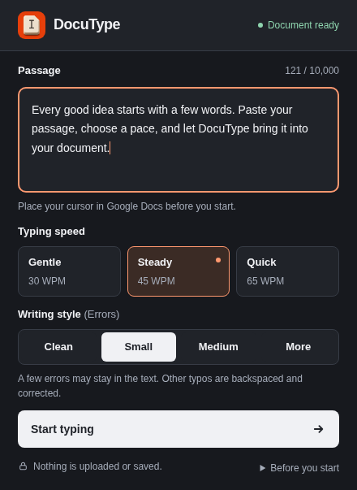

  

  

# DocuType

[View the website and installation guide](https://htmlpreview.github.io/?https://github.com/mrduhlol/DocuType/blob/main/website/index.html)

You can also extract the ZIP and open [website/index.html](website/index.html) in your browser.

## Install

### Chrome

1. [Download the ZIP](https://github.com/mrduhlol/DocuType/archive/refs/heads/main.zip) and extract it.
2. Open `chrome://extensions` and enable **Developer mode**.
3. Click **Load unpacked** and select the extracted folder containing `manifest.json`.
4. Pin DocuType from the extensions menu.

To update, download the latest files and click **Reload** on DocuType in `chrome://extensions`.

### Firefox

1. Download and extract the ZIP above.
2. Open `about:debugging#/runtime/this-firefox`.
3. Click **Load Temporary Add-on…** and select `manifest.json`.

Reload the temporary add-on after each Firefox restart.

## Screenshot

## Features

- **Type into Google Docs:** paste up to 10,000 characters, place your cursor in an editable document, and click **Start typing**.
- **Three speeds:** Gentle (30 WPM), Steady (45 WPM), and Quick (65 WPM), with natural pauses and varied timing.
- **Writing style (Errors):** Clean adds no errors; Small, Medium, and More add increasing amounts of mistakes. Some typos are backspaced and corrected; others remain in the text. Google Docs autocorrect may change them.
- **Live controls:** pause, resume, stop, or change speed from the floating control bar. Approximate progress shows how much has been typed.
- **Light and dark themes:** the popup follows your system appearance.
- **Local processing:** no analytics or passage storage. DocuType itself makes no network requests; text is inserted into your Google Docs document.
